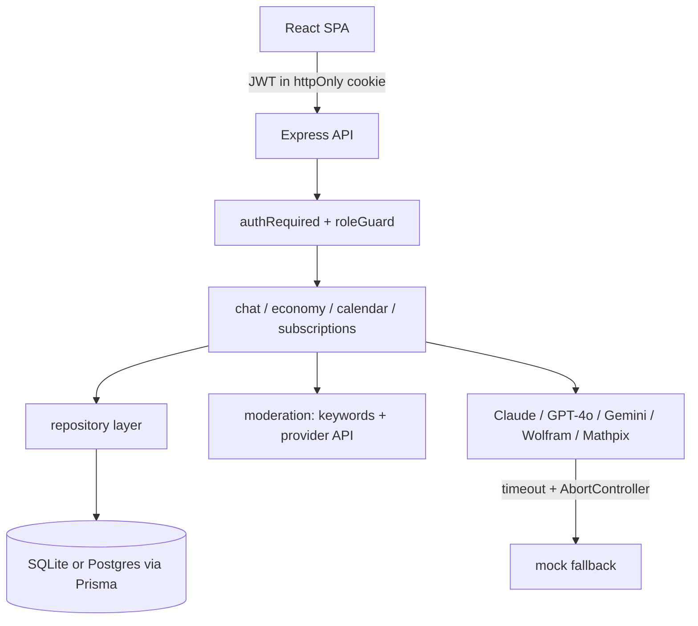

# Mentor AI v3.0 - Improvement Roadmap

Plan de îmbunătățiri pe faze, complementar celorlalte documente din repo:
[file-explicatie.md](file-explicatie.md) descrie arborele de fișiere *așa
cum era la început*, [vulnerabilitati_v2.md](vulnerabilitati_v2.md) analizează
securitatea de atunci, iar [top-50-vulnerabilitati.md](top-50-vulnerabilitati.md)
listează ce trebuia făcut. Documentul de aici a ordonat munca în faze.

**Stare (27 august 2026):** fazele 1–5 sunt pe `main`. Faza 6 este în
[PR #9](https://github.com/Mentor-AI-Orgg/Mentor-AI/pull/9). Ce s-a livrat
efectiv, inclusiv abaterile de la plan (JSON în loc de Prisma, scrypt în loc
de bcrypt, Stripe în loc de Netopia), stă în
[IMPLEMENTARE.md](IMPLEMENTARE.md).

Textul de mai jos este planul original. Unele propoziții („nimic nu este
implementat”, „nu există test file”) nu mai sunt adevărate.

## Where the app stood when this plan was written

The route structure in [backend/server.js](backend/server.js) is clean and modular, and the frontend screens are complete. The problem is that everything underneath is a mock: there is no identity, no persistence, and no real content safety. Because the app serves children (grades 1-12) and exposes parent/teacher views of a minor's activity, the identity and safety gaps are not just technical debt, they are launch blockers.

Two gaps not listed in the existing docs:

- [file-explicatie.md](file-explicatie.md) claims `backend/.gitignore` and `backend/.env.example` exist. Neither file exists in the repo. With no `.gitignore`, a developer who creates `.env` or runs `npm install` risks committing secrets or `node_modules`.
- `backend/node_modules` is not installed, so the app cannot currently be started without `npm install`.

## Target architecture



## Phase 1 - Identity and authorization (blocking)

This is the single highest-value change: every other route's correctness depends on knowing who the caller is.

1. Add `backend/src/routes/auth.js` with `POST /register`, `POST /login`, `POST /logout`, `GET /me`, and `POST /forgot-password`. Hash passwords with `bcrypt` (or `node:crypto` scrypt to avoid a native dep). Issue a JWT in an `httpOnly`, `sameSite=lax` cookie.
2. Add `backend/src/middleware/auth.js` exporting `authRequired` and `roleGuard(...roles)`. Mount it on `/api/economy`, `/api/calendar`, `/api/subscriptions`, and `/api/chat`.
3. Replace every `req.query.user_id || 'demo_user'` and `req.body.user_id` with `req.user.id`. This is the actual IDOR fix; there are roughly 17 occurrences in [backend/src/routes/economy.js](backend/src/routes/economy.js) alone, plus [backend/src/routes/calendar.js](backend/src/routes/calendar.js) and [backend/src/routes/subscriptions.js](backend/src/routes/subscriptions.js).
4. Enforce role server-side at registration. Today a client can simply post `role: 'teacher'`; teacher accounts should require either an invite code or manual approval.
5. Wire the frontend: bind the email/password fields in [frontend/components/LoginScreen.js](frontend/components/LoginScreen.js) to state (they currently have no `value`/`onChange`), and make `handleLogin` in [frontend/app.js](frontend/app.js) call the API instead of `setUserData(prev => ({ ...prev, isLoggedIn: true }))`. Add `credentials: 'include'` to `fetchWithTimeout` in [frontend/apiClient.js](frontend/apiClient.js).
6. Make parent-child and teacher-student links consent-based. `connectParentChild` in [backend/src/data/economyStore.js](backend/src/data/economyStore.js) currently links two accounts from one side's email alone, which hands a stranger the child's `copiedRisk`, `mentorMessages`, and `detectHistory`. Replace with a pending invitation the other account must accept.

## Phase 2 - Persistence

Every `Map` and array in `backend/src/data/` and `memoryStore.js` is wiped on restart, so coins, streaks, purchases, and calendar events are all ephemeral.

1. Introduce Prisma with SQLite for local development and Postgres for production. Model `User`, `Session`, `Wallet`, `Purchase`, `Notification`, `Activity`, `CalendarEvent`, `Subscription`, `Conversation`, `Message`, `AccountLink`.
2. Split the 902-line [backend/src/data/economyStore.js](backend/src/data/economyStore.js) into `userRepo`, `shopRepo`, `notificationRepo`, and `analyticsRepo` behind the same function signatures the routes already call, so route code barely changes.
3. Persist conversation memory. `MAX_MESSAGES = 15` in [backend/src/memory/memoryStore.js](backend/src/memory/memoryStore.js) also contradicts the Pro plan's advertised "memorie conversație persistentă".
4. Fix conversation identity. `chat.js` derives it from the message text itself:

```js
const conversationId = req.body.conversation_id || `conv_${Buffer.from(message).toString("base64").slice(0, 8)}`;
```

Two different students whose first message matches will share one memory. Key conversations by `userId` plus a generated id.

## Phase 3 - Safety, abuse, and privacy

1. Replace the substring match in [backend/src/safety/safetyCheck.js](backend/src/safety/safetyCheck.js) with a real moderation call (OpenAI moderation or Gemini safety settings), keeping the keyword list only as a cheap pre-filter. The current 13-word list is trivially bypassed by diacritics, spacing, or another language, and the file itself carries `//de adaugat` notes.
2. Add `express-rate-limit`, tightest on `POST /api/economy/access-code/verify` and `POST /api/chat`. The OTP is a 6-digit code valid for 10 minutes with unlimited attempts, so the whole keyspace is reachable inside the window. Also add an attempt counter on the `ACCESS_CODES` entry and hash the stored code.
3. Lock down CORS. `app.use(cors())` in [backend/server.js](backend/server.js) allows any origin, which matters as soon as cookie auth exists. Use an explicit allowlist with `credentials: true`.
4. Validate request bodies with Zod at the route boundary; validation today is ad hoc and inconsistent.
5. Relabel or replace the AI-text detector. `detectService.js` mixes heuristics with `Math.random()` yet reports `confidence: "high"` to teachers, who may act on it. Either integrate a real service or label it clearly as a demo in the UI.
6. Add parental consent and a privacy policy before collecting minors' activity data, plus data export and deletion endpoints.

## Phase 4 - Provider and API hardening

1. Add `AbortController` timeouts to all five providers in `backend/src/providers/`. The frontend has a 6s timeout but the backend chains have none, so one hung provider stalls the whole fallback chain in [backend/src/routes/chat.js](backend/src/routes/chat.js).
2. Surface mock mode in the UI. `engine_mocked` is already returned by the API; make it visible so a user never mistakes a mock reply for a real one when a key expires.
3. Raise `max_tokens: 500` in the Claude and OpenAI providers, which can truncate multi-step scaffolding answers.
4. Version the API as `/api/v1` and document it with OpenAPI.
5. Add TTL cleanup for `NOTIFICATIONS`, `ACCESS_CODES`, and conversation memory, which currently grow without bound.
6. Handle `SIGTERM`/`SIGINT` in [backend/server.js](backend/server.js) for graceful shutdown.

## Phase 5 - Frontend build and quality

1. Migrate to Vite. Today [frontend/index.html](frontend/index.html) loads Babel Standalone and compiles every component in the browser on each visit, and Tailwind's own docs say the CDN build is not for production.
2. Replace the `window.ComponentName` globals with ES module imports, and split the 1244-line [frontend/app.js](frontend/app.js) by screen.
3. Extract UI strings into i18n files. Prompts cover 11 languages in [backend/src/data/systemPrompts.js](backend/src/data/systemPrompts.js) but the interface is hardcoded Romanian.
4. Add Vitest plus Supertest coverage starting with auth, the chat fallback chain, and economy purchases; there is currently no test file in the repo.
5. Add ESLint, Prettier, and a GitHub Actions workflow running lint, tests, and `npm audit`. Normalize the mixed CRLF/LF line endings via `.gitattributes`.

## Phase 6 - Product polish

1. Real payments through Stripe or Netopia, replacing the mock checkout in [backend/src/routes/subscriptions.js](backend/src/routes/subscriptions.js).
2. Real Google Calendar and Notion OAuth, replacing the mock connect in `calendarStore.js`.
3. A real leaderboard computed from activity instead of the 10 hardcoded names in `backend/src/data/leaderboard.js`, with pseudonyms rather than children's real names.
4. Actual SMS and email delivery; `pushNotification` only stores messages in memory today, even though the parent access code is presented to users as arriving by SMS.
5. Persist onboarding progress and `FocusTimer` state, add a purchase confirmation step in the shop, and honor `prefers-reduced-motion` for the WebGL backgrounds.

## Immediate housekeeping

- Add a root `.gitignore` covering `node_modules`, `.env`, and logs. There is none today, which is a live secret-leak risk.
- Add `backend/.env.example` documenting all six keys and noting that partial Mathpix credentials silently fall back to mock.
- Rewrite [README.md](README.md), which is currently just three links, into real setup instructions.

## Domain name suggestions (.ro)

All five need to be checked against the registry at rotld.ro, since availability cannot be verified from the repo.

- **mentorai.ro** - the exact product name, shortest and most brandable option, worth pursuing first.
- **mentorultau.ro** - "mentorul tău", matching the app's own in-product heading "PROFESORUL TĂU" and its second-person voice.
- **invatacumentor.ro** - "învață cu mentor", descriptive and close to the existing tagline "Învață cu direcție".
- **mentoria.ro** - a coined single word, easy to say and spell, and it works in both Romanian and English.
- **pasulurmator.ro** - "pasul următor", which captures the scaffolding philosophy of guiding to the next step rather than giving the answer.

Practical notes: prefer a name under 12 characters that survives being read aloud over the phone, avoid diacritics in the domain itself (they hurt typing even where IDN is supported), and register the matching `.com` defensively if the brand sticks.
